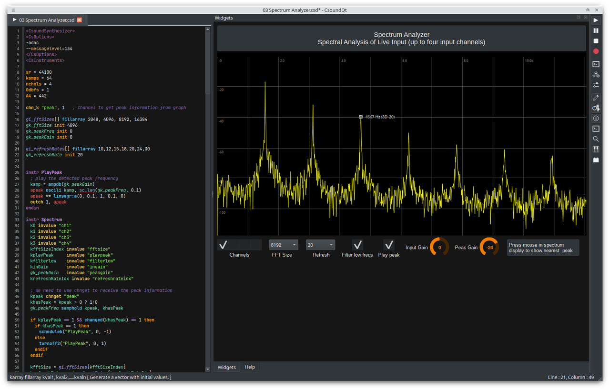

CsoundQt is a **frontend for [Csound](http://csound.github.io/)** featuring a
highlighting editor with autocomplete, interactive widgets and integrated
help. It is cross-platform and aims to be a complete
development environment for Csound. 

Csound itself is a musical programming language with a very long history and roots
in the origins of computer music. It is being actively maintained and is still one 
of the most powerful tools for sound processing and synthesis. 

<video width="100%" controls preload="metadata">
  <source src="videos/csoundqt-waveform2.mp4" type="video/mp4">
  Your browser does not support the video tag.
</video>

-   :material-download: **Get CsoundQt**

    ---

    Download the latest release for macOS, Windows or Linux.

    [:octicons-arrow-right-24: Install](install.md)

-   :material-help-circle: **Get help**

    ---

    Find your way around with the [Help](help.md) page, the mailing list and
    the issue tracker.

    [:octicons-arrow-right-24: Help](help.md)

-   :material-newspaper-variant-outline: **News**

    ---

    Release notes and other announcements.

    [:octicons-arrow-right-24: News](news/index.md)

-   :material-hand-heart: **Contribute**

    ---

    Report errors, build CsoundQt yourself or help improve the sources.

    [:octicons-arrow-right-24: Contribute](contribute.md)

-   :material-robot: **About CsoundQt**

    ---

    Background, license and the people behind the project.

    [:octicons-arrow-right-24: About](about.md)

-   :material-book-open-variant: **Documentation**

    ---

    The CsoundQt manual, updated for CsoundQt 7.x.

    [:octicons-arrow-right-24: Manual](reference/index.md)

