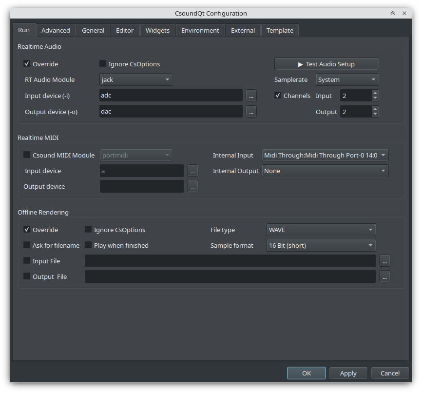
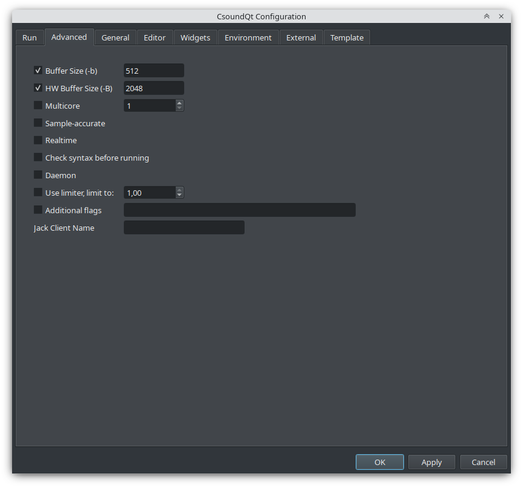
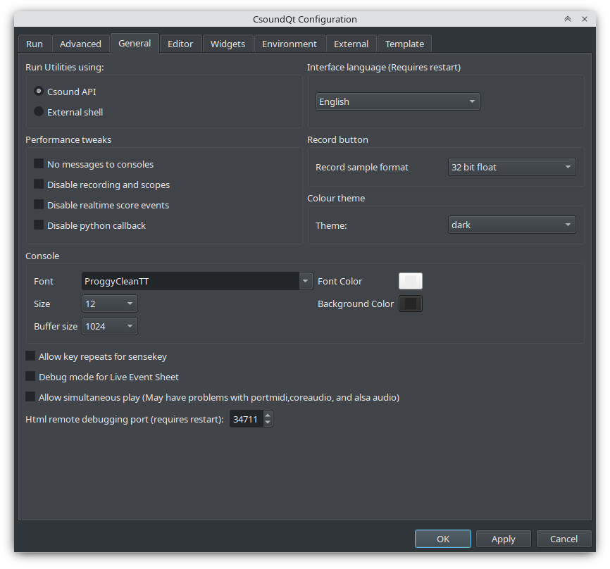
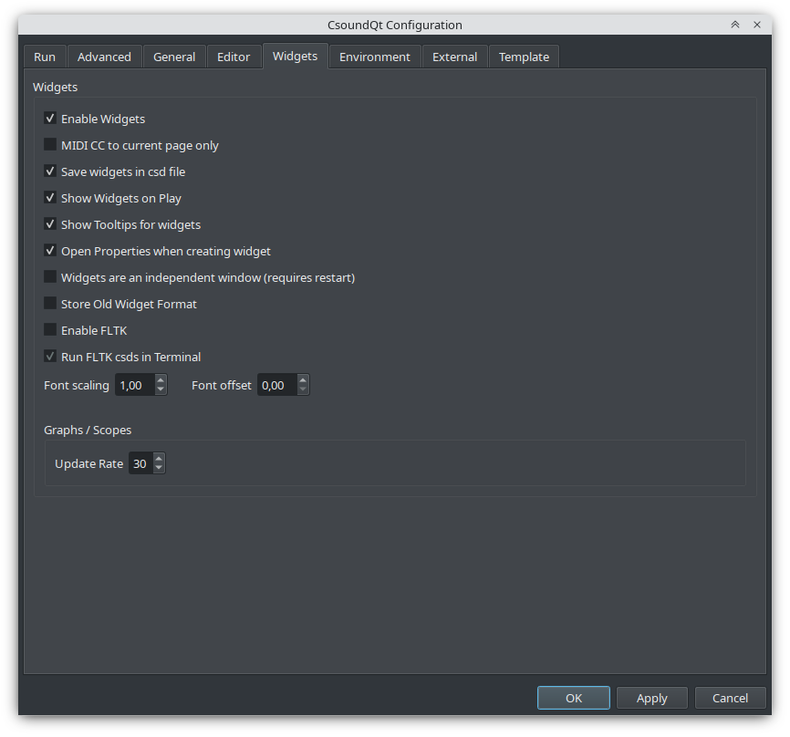
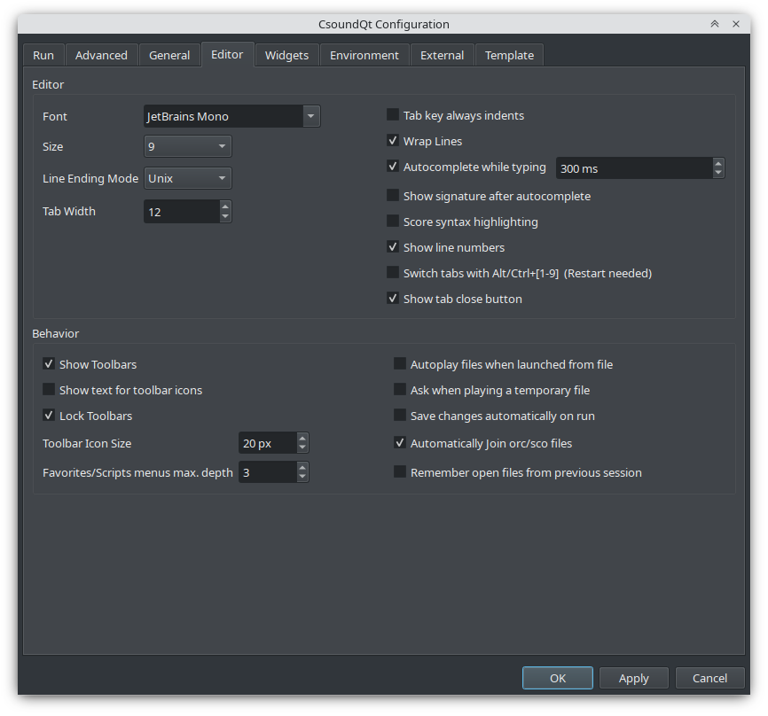
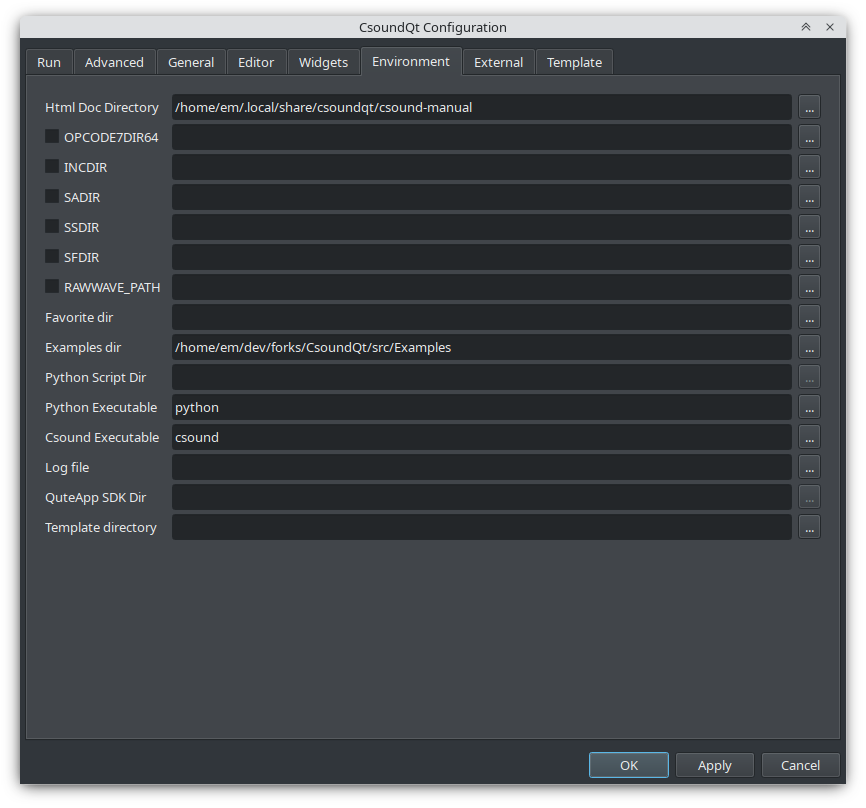
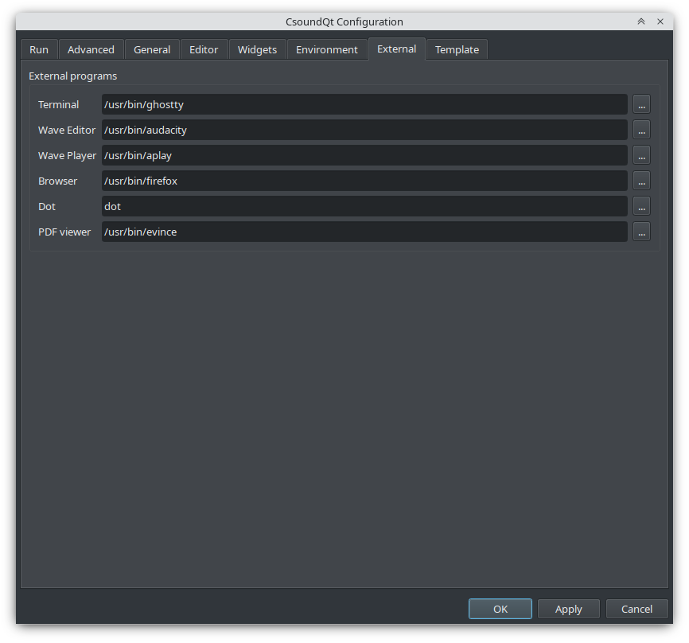
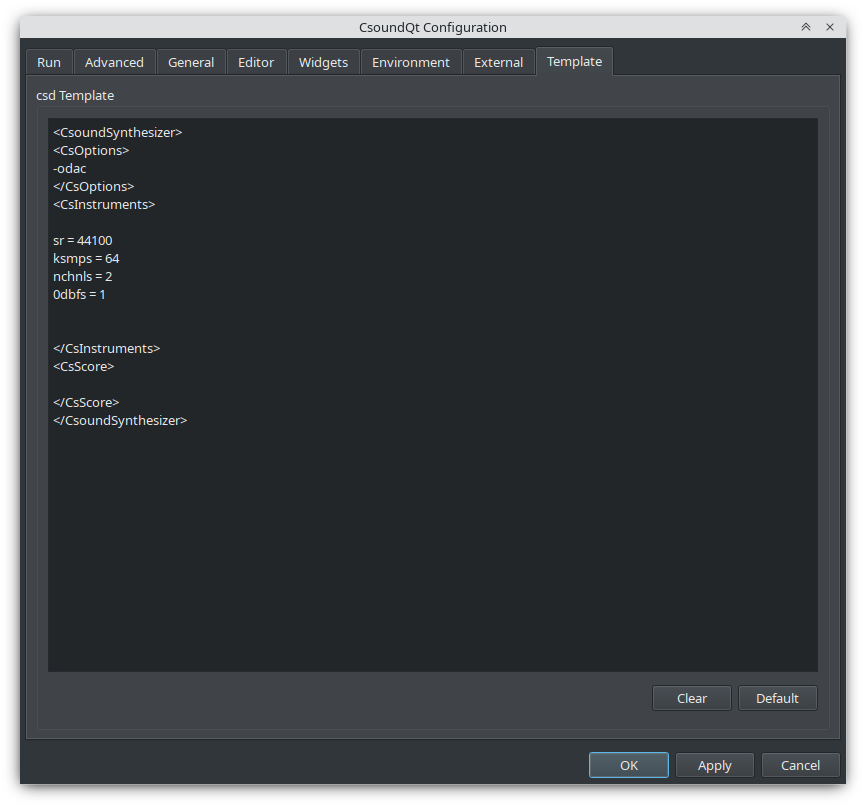

CsoundQt gives easy access to the most important [Csound options](https://csound.com/docs/manual/CommandFlags.html) and to many specific CsoundQt settings via its Configuration Panel.

To open the configuration panel push the *Configure* button, choose *Edit > Configuration* (*Ctrl+,*), or right-click a widget panel. The dialog has eight tabs, all shown here as of CsoundQt 7.2 (Fusion style, dark theme).

### Run

**Realtime Audio** — options used when you push the *Run* button (or *Control > Run Csound*), i.e. realtime performance to the sound card:

- **Override** — tick to activate the CsoundQt options configured here.
- **Ignore CsOptions** — ignore the options embedded in the `<CsOptions>` section of the csd. For beginners it is recommended to tick this together with *Override*; experienced users may leave it unchecked to allow extra options (e.g. `-m128` to reduce Csound's printout). On conflict, the CsoundQt options have priority.
- **RT Audio Module** — very much dependent on your operating system. If you experience crashes or bad realtime performance, try another module. Common choices: `alsa` or `jack` on Linux, `coreaudio` or `portaudio` on macOS, `portaudio` on Windows.
- **Input device (-i) / Output device (-o)** — the devices for realtime input (e.g. a microphone) and output. The usual choice is *adc* / *dac* (the system defaults); click `...` for a device list, or choose *no input* if you have no realtime input. Note: the portaudio module usually requires the same number of input and output channels — with stereo output and a mono microphone you may get `*** PortAudio: error: -9998: Invalid number of channels`; use `nchnls_i = 1` in that case.
- **Test Audio Setup** — checks the selected audio configuration.
- **Samplerate / Channels** — samplerate and number of input/output channels.

**Realtime MIDI** — the MIDI module and devices Csound itself uses (this is *not* the widget MIDI mapping, see *General* and [Widgets](widgets.md)):

- **Csound MIDI Module** — try another module if you have MIDI problems; select *none* if you use no MIDI at all. Common choices: `alsa` or `portmidi` on Linux, `coremidi` or `portmidi` on macOS, `portmidi` on Windows.
- **Input / Output device** — usually *a* (all MIDI devices) for input; use `...` for a device list where supported.
- **Internal Input / Internal Output** — the MIDI ports CsoundQt's own widgets listen to (see [Widgets](widgets.md) MIDI Learn).

**Offline Rendering** — behavior for *Render* (*Control > Render to file*):

- **Override / Ignore CsOptions** — as above, but for file rendering.
- **File type / Sample format** — the output file format.
- **Input File / Output File** — correspond to the `-i` / `-o` flags. There is also *Ask for filename* and *Play when finished*.

### Advanced

Realtime performance flags (the `-b`/`-B`/`-j` family and extras):

- **Buffer Size (-b)** — software buffer size. Hints: always use power-of-two values; `ksmps` is usually 1/4 or 1/2 of it (for live input/output use an integer multiple — "full duplex audio"); smaller values (e.g. 128) reduce latency for live performance, larger values (e.g. 1024) suit file playback. Per the manual the defaults are 256 (Linux), 1024 (macOS), 4096 (Windows).
- **HW Buffer Size (-B)** — hardware buffer size; commonly 4× the software buffer size. Its exact role depends on the audio module (matters for coreaudio/jack/alsa, only a latency hint for portaudio, unused for pulse).
- **Multicore** — corresponds to the `-j` flag (parallel processors). Use with care; it does not always improve performance, depending on the csd structure.
- **Sample-accurate** — sample-accurate event timing.
- **Realtime** — realtime priority scheduling.
- **Check syntax before running** — syntax check without performing.
- **Daemon** — run as a daemon process.
- **Use limiter** — output limiter with adjustable limit.
- **Additional flags** — any further [command-line options](https://csound.com/docs/manual/CommandFlags.html). Only use if you know what you are doing!
- **Jack Client Name** — name for communicating with a Jack audio client (`*` means all clients).

### General

- **Run Utilities using** — whether the Csound [Utilities](utilities.md) (e.g. `sndinfo`, `pvanal`) run via the Csound API or an external shell.
- **Interface language** (requires restart).
- **Performance tweaks** — important for realtime use: *No messages to consoles*, *Disable recording and scopes* (CsoundQt's Record facility and the Scope widget), *Disable realtime score events* (no live events from Button widgets or the Live Event Sheet), *Disable python callback*.
- **Record button** — bit depth for the Record facility (32 bit float recommended; it can hold 'clipped' samples for later normalisation).
- **Colour theme** — light/dark themes; can follow the system and switch at runtime.
- **Console** — font, font color, size, background color and message buffer size for the Csound output console.
- **Allow key repeats for sensekey** — whether holding a key repeats it for the [sensekey](https://csound.com/docs/manual/sensekey.html) opcode.
- **Debug mode for Live Event Sheet**.
- **Allow simultaneous play** — play more than one csd tab at the same time (may have problems with portmidi, coreaudio and alsa audio).
- **Html remote debugging port** (requires restart).

### Widgets

- **Enable Widgets** — if unchecked, no CsoundQt widgets can be used.
- **MIDI CC to current page only** — widget MIDI mapping reacts only on the current tab.
- **Save widgets in csd file** — each csd stores widget and preset sections (hidden in CsoundQt, visible in a text editor). Uncheck only to export a csd without widget data.
- **Show Widgets on Play** — pop up the widget panel on Run.
- **Show Tooltips for widgets** — hovering a widget shows its channel name.
- **Open Properties when creating widget** — enter channel name and properties right away.
- **Widgets are an independent window** (requires restart) — detach the widget panel from the dock layout.
- **Store Old Widget Format** — additionally save the legacy Mac Csound widget format.
- **Enable FLTK** — outdated built-in [FLTK](https://csound.com/docs/manual/ControlFltkIntro.html) widgets; usually off since they can conflict with CsoundQt widgets. **Run FLTK csds in Terminal** executes such files externally to avoid conflicts.
- **Font scaling / Font offset** — widget label font adjustments.
- **Graphs / Scopes: Update Rate** — refresh rate for graph and scope widgets.

### Editor

- **Font / Size / Line Ending Mode / Tab Width** — editor typography.
- **Tab key always indents**, **Wrap Lines**, **Autocomplete while typing** (with delay), **Show signature after autocomplete**, **Score syntax highlighting**, **Show line numbers**, **Show tab close button**, **Switch tabs with Alt/Ctrl+[1-9]** (restart needed).
- **Behavior**: toolbar visibility and locking, toolbar icon size, Favorites/Scripts menu depth, *Autoplay files when launched from file*, *Ask when playing a temporary file*, *Save changes automatically on run*, *Automatically Join orc/sco files*, *Remember open files from previous session*.

### Environment

- **Html Doc Directory** — folder with the Csound Manual. The AppImage/Flatpak bundles ship the manual; for other installs set it here if the Help panel shows "not found!".
- **OPCODE7DIR64** — extra opcode/plugin directory.
- **INCDIR / SADIR / SSDIR / SFDIR** — include, sound-analysis, sample and sound-file directories (`SSDIR` lets e.g. [diskin](https://csound.com/docs/manual/diskin.html) find samples by name).
- **RAWWAVE_PATH** — raw wave path.
- **Favorite dir** — appears as the *Favorites* menu.
- **Examples dir** — root of the *Examples* menu.
- **Csound Executable** — the `csound` binary used for *Run in Terminal* and utilities.
- **Log file**, **QuteApp SDK Dir**, **Template directory**.

### External Programs

Terminal, Wave Editor, Wave Player, Browser, PDF viewer, and **Dot** (the [graphviz](https://www.graphviz.org) executable used by *View > View Code Graph*).

### Template

Default template for new csds — a real timesaver. *Clear* empties it, *Default* restores the factory template.
