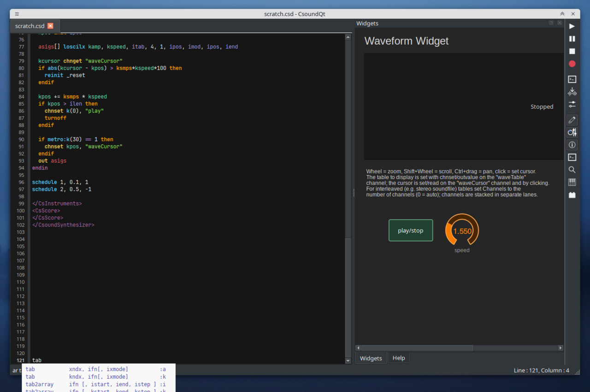
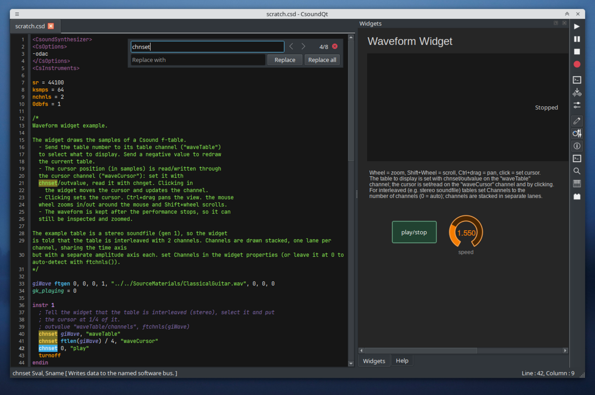
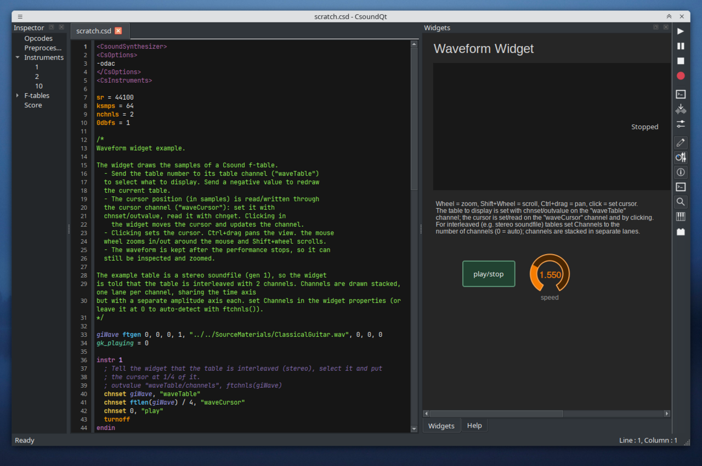
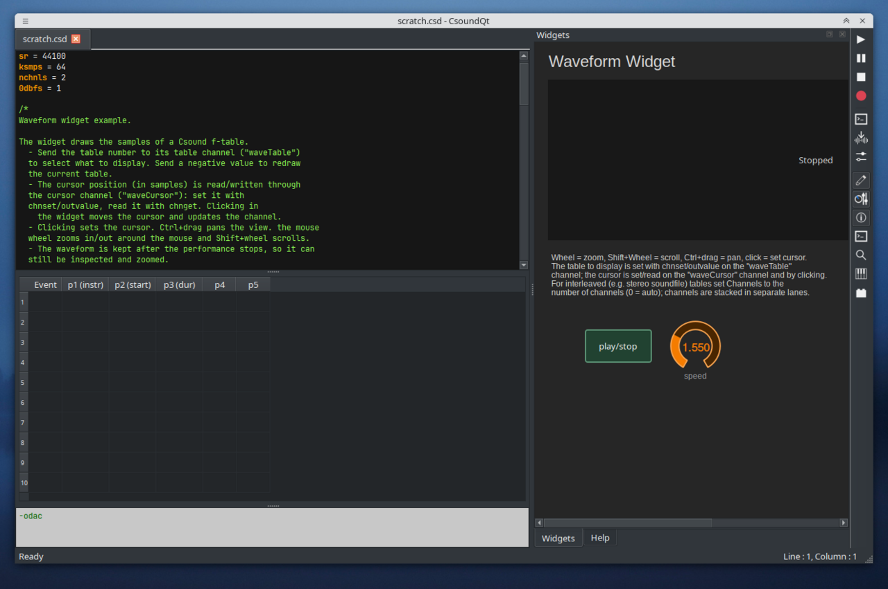

You can find a short description of all Menu Items in the [Menu](csoundqt-menus.md) section of this documentation. This page focusses on some features of the CsoundQt Editor.

##Code completion

When you type, for instance, the letters "tab", you will see different options for code completion:

Choose one of them with the mouse or the arrow key. You have two choices now:  
— **tab** will only complete the opcode name;  
— **return** will also insert the arguments with the names found in the manual.

Any of your own variable names will offer self-completion, too. Autocomplete covers opcodes, instrument names, macros and `@global` variables.

##Inline find bar

CsoundQt 7 replaces the old find-and-replace dialog with an inline floating
find bar: incremental matching, automatic wrap-around, highlighting of all
matches, and jumping between matches. Open it with *Ctrl+F* (find next/previous
with *Ctrl+G* / *Shift+Ctrl+G*).

##Other editor features

- Font zoom, split orchestra/score view with score column-header detection.
- Auto-reload when the file changes on disk; open files by drag & drop.
- Hide/show the editor with *Ctrl/Cmd+0* when working with an external editor.

##Access to the Csound Manual

When you select any opcode (double-click on it), or have the cursor in it, you can get the corresponding page of the integrated Csound Manual by selecting *Help > Show Opcode Entry* (or Shift+F1). The manual viewer supports whole-manual search, a find box, history, zoom and text selection.

You can also find a short info about the opcode at the bottom of the Editor's panel.

##Inspector

When you click on the *Inspector* button (or *View > Inspector*), you get a panel which is quite useful for extended Csound code:

You can navigate easily to any part of the code, or in the score.

##Split View

Instead of the usual raw-text mode, CsoundQt offers a split view for both, the orchestra and the score. Go to *View > Split View*, and you will see the score changed to a spread-sheet-like view, and the tags (CsOptions etc) disappeared. You can choose which sections to show or to hide:

##Recompile live / evaluate code

Since Csound 6, it is possible to change any instrument definition while Csound is running. CsoundQt provides an easy way of recompiling, and can also evaluate code against a running instance (live code evaluation) plus a Scratch Pad. This be your Csound code:

    instr 1
        schedkwhen metro(1), 0, 0, 2, 0, 1
    endin
    instr 2
        prints "Hallo\n"
    endin
    schedule(1,0,1000)

Run this code and change the print statement in instrument 2 from "Hallo\n" to "HalloHallo\n" or whatever. Nothing will happen, as Csound needs a command to recompile instrument 2. Now place the cursor anywhere in instrument 2, go to the Edit menu, and select *Evaluate Section*. You will see a message in the console: "Csound code evaluated.", and after this message you will see the new printout.
