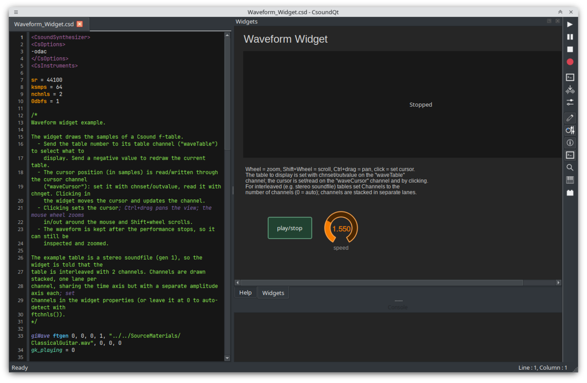

CsoundQt is a frontend for [Csound](https://csound.com) featuring a highlighting editor with autocomplete, interactive widgets and integrated help. It is a cross-platform and aims to be a simple yet powerful and complete development environment for Csound.

> CsoundQt 7 requires **Qt 6** and **Csound 7**. 

The main parts of CsoundQt are:

+ The [**Editor**](editor.md) which offers syntax highlighting, self-completion of opcode names and other parts of the code, optional split view including a spread-sheet like display of the score, an inline find bar, and the integrated Csound Manual with whole-manual search.
+ The [**Widgets**](widgets.md) which extend Csound by standard graphical elements like sliders, 
  number boxes, buttons etc. Widgets communicate through Csound channels, mainly via the `chnget` and `chnset` 
  optocdes. Any widget property can be modified from csound with `outvalue "<channel>/<property>", value`.
+ Different [**Run**](run.md) options, including live modification and scheduling of instruments. 
  MIDI is handled by CsoundQt and every widget can be bound via `MIDI learn` to any controller.
+ A **Live Event Sheet** (see the original pages under [Legacy documentation](../legacy/index.md)) which allows easy and multi-layered real-time generation of score events, including loops and some on-the-fly manipulation of scorelines.
+ Easy access to the Csound [**Utilities**](utilities.md) with interactive adjustment of parameters.

CsoundQt 7 brings light/dark themes that can follow the system, a much faster startup, and self-contained 
**AppImage** and **Flatpak** packages that bundle Qt, Csound, the manual and plugins.

The [**Menu Short Reference**](csoundqt-menus.md) doc explains all menu items in short.  
The [**Configuration**](configuring-csoundqt.md) doc is about the various configuration settings in CsoundQt (including Csound).  
[**Tips and Tricks**](tips-and-tricks.md) can help to overcome some common issues.
